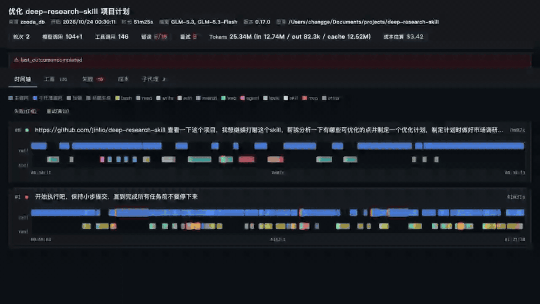
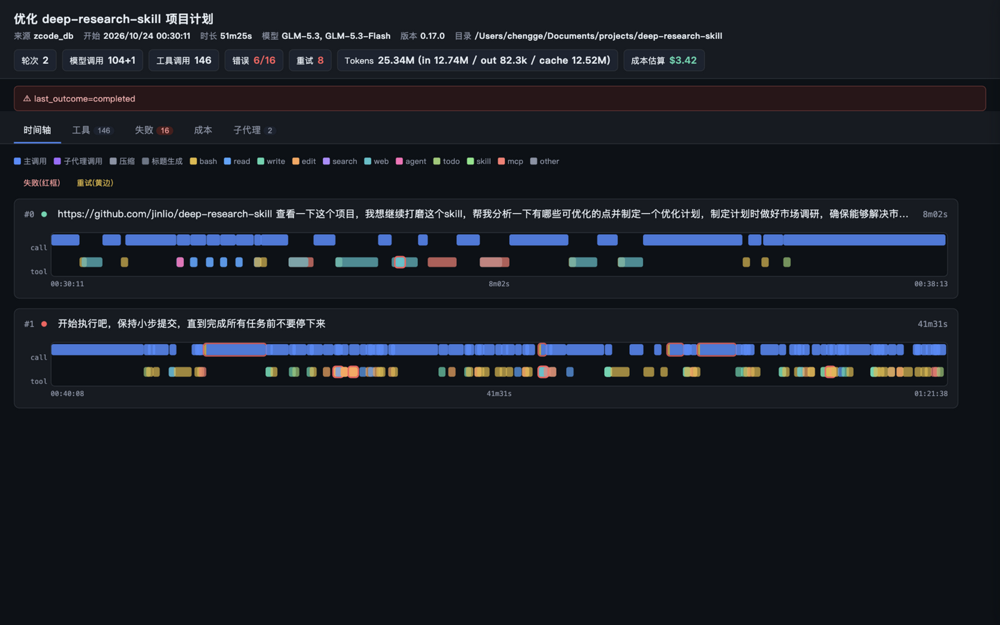
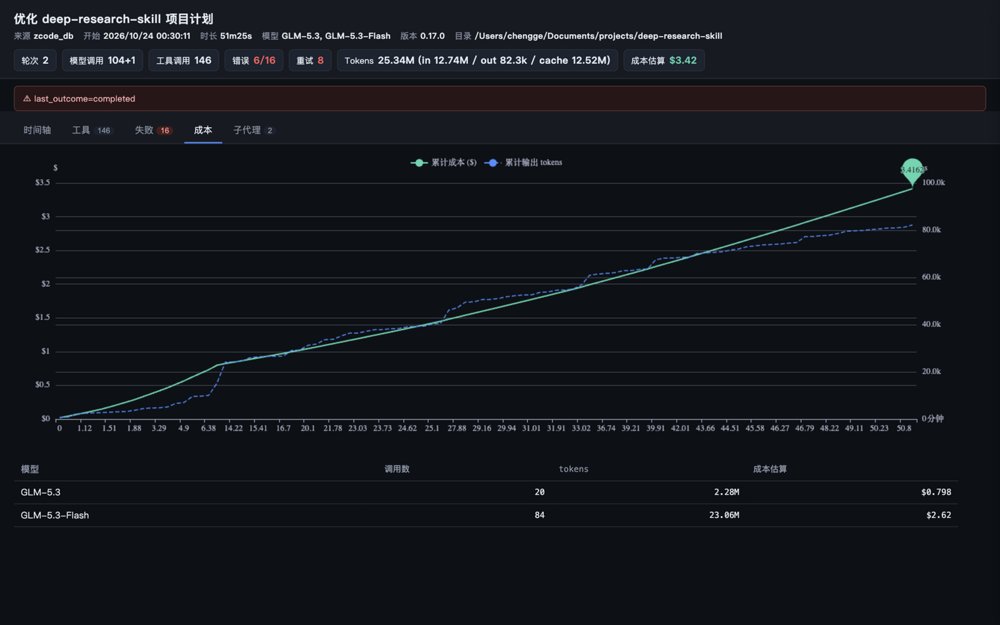

# Agent X-Ray 🔬

[](https://github.com/jinlio/agent-xray/actions/workflows/ci.yml)
[](https://pypi.org/project/agentxray-replay/)
[](https://pypi.org/project/agentxray-replay/)
[](LICENSE)

**零埋点、纯本地的编码 agent 会话回放器**——把 Claude Code / ZCode 的会话日志变成一张可交互的**执行 X 光片**：执行时间轴、工具调用树、token/成本曲线、失败点高亮。输出**单个 HTML 文件**，双击即看，可直接扔进 PR / 邮件分享。



"刚才那 40 分钟 agent 到底干了什么？钱花哪了？从哪一步开始跑偏？"——`grep`/`jq` 翻几千条 JSONL 回答不了这些问题，云端观测平台（Langfuse/LangSmith）要求改代码接入且数据要出本地。Agent X-Ray 直接吃**已经存在的**本地日志，什么都不用改。

## 它长什么样

**执行时间轴**——每轮对话一条泳道，上层是模型调用（按来源着色），下层是工具调用（按类别着色），失败红框、重试黄边、上下文压缩菱形标记。点击任意段展开完整详情（思考过程 / 回复 / 工具输入输出 / token / 成本）：



**成本曲线**——随时间累积的 token/费用，标注峰值，按模型分列：



## 30 秒上手

```bash
# 安装（零依赖，纯标准库 + 内联 ECharts）
uv tool install agentxray-replay   # 或: pipx install agentxray-replay / pip install agentxray-replay
                                   # PyPI 包名 agentxray-replay（agent-xray 被占用），命令可简写 agent-xray

agent-xray                         # 列出 ZCode 的全部本地会话
agent-xray --summary               # 最近一次会话的终端摘要（含失败点清单）
agent-xray --session 3             # 渲染第 3 个会话 → ./agent-xray-out/xxx-xray.html
agent-xray --session 3 --open      # 渲染并在浏览器打开

# Claude Code 转录（experimental）
agent-xray ~/.claude/projects/<proj>/<session>.jsonl
agent-xray ~/.claude/projects/<proj>/        # 目录批量 + 索引页
```

终端摘要示例（真实会话输出）：

```
# 优化 deep-research-skill 项目计划
  轮次 2 · 模型调用 91 (+1 后台) · 工具 128 · 重试 8
  tokens: in 10.32M / out 74.8k / cache 10.10M (合计 20.50M)
  成本估算: $2.8754
  失败点 (16):
    [模型调用失败] turn #1: Cannot connect to API: Connect Timeout Error (zcode.z.ai:443)
    [重试] turn #1: GLM-5.3-Flash needed 6 attempts
    [工具失败] turn #1: Edit: File has not been read yet. ...
  工具 Top: Bash×38(1 err) · Write×24 · Edit×23(2 err) · Read×18
```

## 支持的数据源

| 数据源 | 位置 | 状态 |
|---|---|---|
| **ZCode** | `~/.zcode/cli/db/db.sqlite`（自动发现，只读快照，不影响运行中的 ZCode） | ✅ 主源，实测 6 周 / 141 会话 / 9.8k 模型调用全量解析通过 |
| **Claude Code** | `~/.claude/projects/**/*.jsonl` | ⚠️ **experimental**：按公开格式文档开发（本机无 CC 日志），含流式拆行合并、tool_use↔tool_result 配对、sidechain 子代理提取；遇到不兼容请附（脱敏）样本提 issue |
| 通用 | 自定义适配器（约 100 行 Python 即可接入新格式） | 🚧 v1.0 计划 |

其他命令：`--list`（列表）、`--all --limit 20`（批量渲染 + 索引页）、`--trunc N` / `--full`（文本截断控制）、`--price-file`（自定义价格表）、`--db`（指定 sqlite 路径）。

## 隐私

- 解析**全部在你的机器上**完成；产物是一个本地 HTML 文件
- HTML 里**没有一句代码会联网**——ECharts 已内联，双击离线可看
- 不上传、不匿名统计、没有 telemetry
- 成本为**本地估算**（内置价格表可被 `--price-file` 覆盖），非账单数据

## FAQ

**Q: 和 ccusage 有什么区别？**
ccusage 回答"花了多少钱"（账单视角），Agent X-Ray 回答"agent 到底做了什么、哪一步走歪"（病理片视角）。成本曲线只是 X 光片上的一条线；核心是执行时间轴与失败分析。两者可互补使用。

**Q: 和 Langfuse / LangSmith 有什么区别？**
它们要求改代码接入 SDK、数据发到服务端，且对**已发生**的历史会话无能为力。Agent X-Ray 零埋点、纯本地、专吃历史日志。

**Q: ZCode 格式变更了怎么办？**
适配器对每张表做能力探测，缺哪张表/列就降级（比如没有 usage 表时从消息时间戳推耗时），永不 crash，降级项会写进页面警告条。

**Q: 大会话会不会卡？**
实测 2633 条消息 / 2273 次模型调用的会话 → 9.9MB 单文件 HTML，现代浏览器可流畅交互。默认截断长文本（`--trunc 2000`），`--full` 可关闭。

**Q: 为什么是单文件 HTML？**
因为它的最高频用途是"扔给别人看"——放进 PR、贴进群、发邮件，一个文件就够了，无需对方装任何东西。

## 开发

```bash
git clone <repo> && cd agent-xray
uv sync            # 安装 dev 依赖（pytest/ruff）
uv run pytest      # 16 个测试：合成 fixture + golden 快照 + 健壮性 + CLI
uv run ruff check src tests
uv run agent-xray --list
```

架构刻意保持极简：`格式适配层（zcode_db / claude_code）→ 统一事件模型（Session/Turn/ModelCall/ToolUse）→ 单文件渲染器`。适配 Claude Code 约花了一个下午；欢迎为新 agent 提 PR。

## License

MIT
